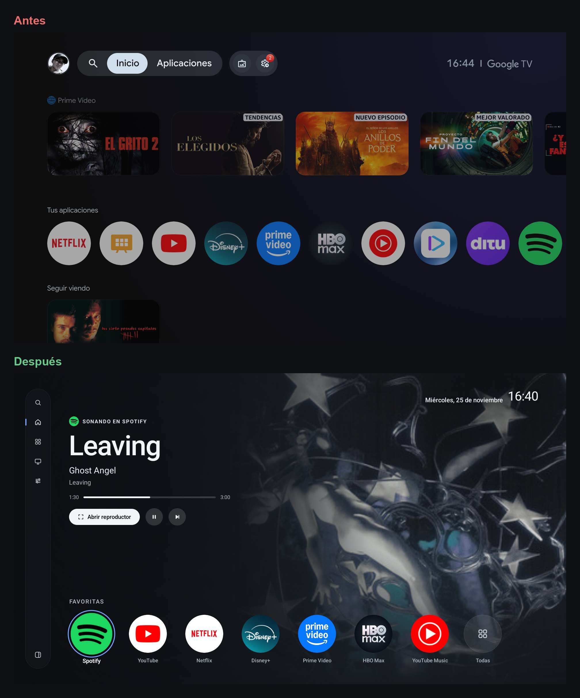
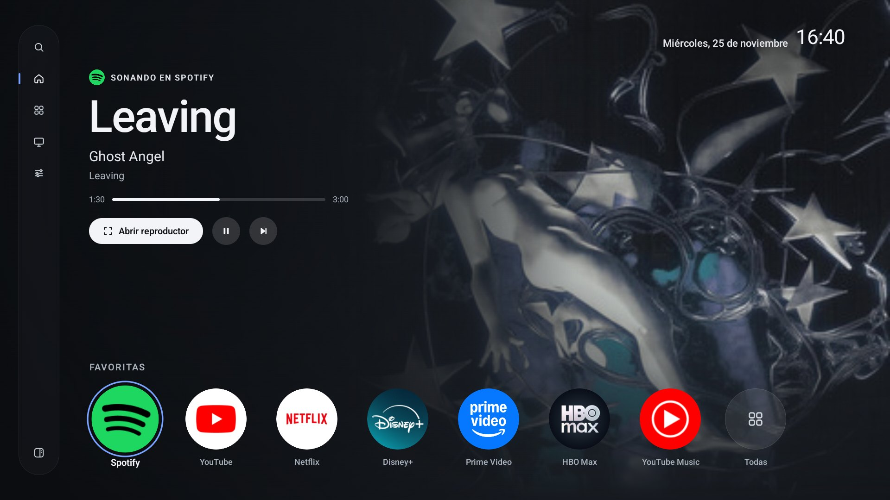
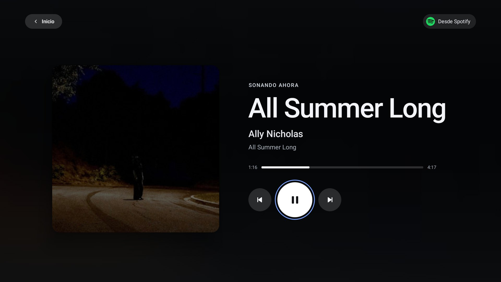
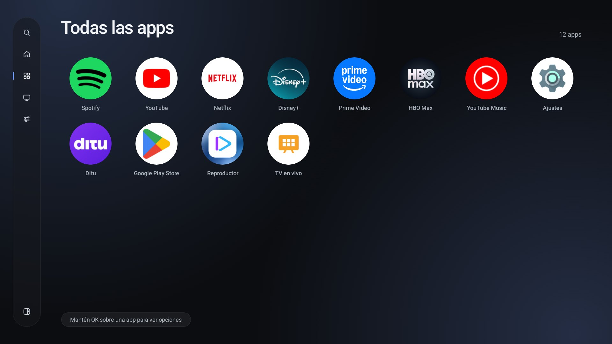
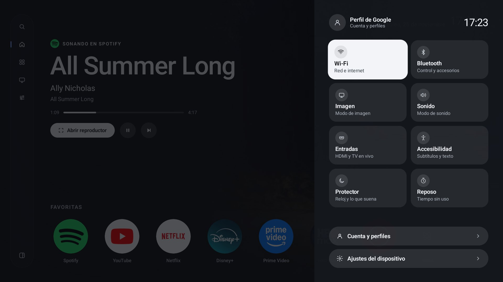
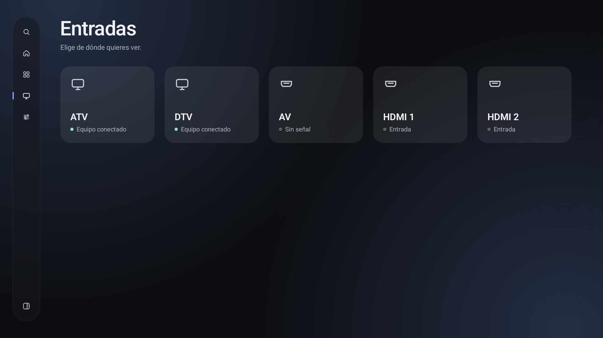
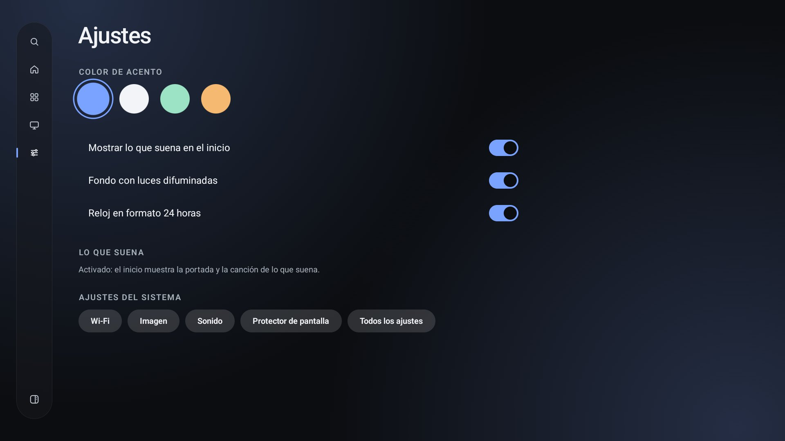

# TV Launcher

Launcher propio para **Android TV / Google TV**: oscuro, minimalista y sin anuncios.
Pone al frente lo que estás escuchando o viendo y tus apps favoritas, nada más.

Hecho en Kotlin con Jetpack Compose, pensado para pantallas 1920×1080 y control remoto.


## Antes y después

Inicio de fábrica de Google TV frente al launcher, en el mismo televisor.



## Pantallas

| Inicio | Reproductor |
| --- | --- |
|  |  |
| **Todas las apps** | **Panel rápido** |
|  |  |
| **Entradas** | **Ajustes** |
|  |  |

## Funciones

- **Inicio** con un fondo a pantalla completa que cambia según la app enfocada. Si algo suena,
  muestra la portada real, canción, artista y progreso, con controles de reproducción.
- **Lo último de cada app:** cada app muestra solo su propio contenido, y se recuerda lo último
  que sonó en ella aunque ya no esté reproduciendo.
- **Transiciones suaves** entre canciones y vistas, ajustadas para GPUs modestas de televisor.
- **Favoritas** en círculos con el ícono real de cada app.
- **Todas las apps:** mantener OK (o la tecla Menú) abre opciones para agregar a favoritas, mover,
  ocultar o ver información.
- **Buscar:** apps al instante, búsqueda en Google, YouTube y Play Store, y voz con el Asistente.
- **Entradas:** HDMI, AV y TV en vivo con su estado de señal.
- **Panel rápido:** Wi-Fi, Bluetooth, imagen, sonido, entradas, accesibilidad, protector,
  reposo, cuenta y ajustes del dispositivo.
- **Reproductor** a pantalla completa y **protector de pantalla** propio con reloj y lo que suena.
- **Personalizable:** color de acento, reloj de 12 o 24 horas y fondo con luces difuminadas.

## Requisitos

- Android TV o Google TV con Android 8.0 (API 26) o superior.
- JDK 17 y Android SDK 34 para compilar.
- Depuración por ADB activada en el televisor.

## Compilar e instalar

Usa la versión release: la de depuración tarda unos 6 s en mostrar el inicio y esta menos de 1 s.

```bash
./gradlew assembleRelease
```

```bash
adb install -r app/build/outputs/apk/release/app-release.apk
```

Dale permiso para leer lo que suena (una sola vez):

```bash
adb shell cmd notification allow_listener dev.tvlauncher/dev.tvlauncher.media.MediaListenerService
```

Para probarlo sin cambiar el inicio del televisor:

```bash
adb shell am start -n dev.tvlauncher/.MainActivity
```

## Usarlo como inicio

```bash
adb shell cmd package set-home-activity dev.tvlauncher/.MainActivity
```

En Google TV eso no basta, porque su inicio de sistema se impone al botón Home. Para que Home
abra este launcher hay que desactivar el inicio de Google (no se borra, solo se desactiva):

```bash
adb shell pm disable-user --user 0 com.google.android.tungsten.setupwraith
```

```bash
adb shell pm disable-user --user 0 com.google.android.apps.tv.launcherx
```

### Volver al inicio de Google TV

```bash
adb shell pm enable com.google.android.apps.tv.launcherx
```

```bash
adb shell pm enable com.google.android.tungsten.setupwraith
```

```bash
adb shell cmd package set-home-activity com.google.android.apps.tv.launcherx/.home.HomeActivity
```

> No apagues la depuración inalámbrica: es la vía para revertirlo si algo falla.

## Estructura

```
app/src/main/java/dev/tvlauncher/
├── MainActivity.kt        Punto de entrada (HOME y LEANBACK_LAUNCHER)
├── data/                  Apps instaladas, íconos, favoritas y preferencias
├── media/                 Sesiones de medios: lo que suena y lo último de cada app
├── dream/                 Protector de pantalla
└── ui/                    Pantallas en Compose, tema y componentes
```

## Límites conocidos

- Android no deja que un launcher de terceros lea "Seguir viendo" ni las recomendaciones de otras apps.
- El fondo del Panel rápido es casi opaco: Android no permite desenfocar lo que hay detrás de una ventana de app.

## Licencia

Distribuido bajo la licencia Apache 2.0. Consulta [LICENSE](LICENSE).
